<p align="center">
  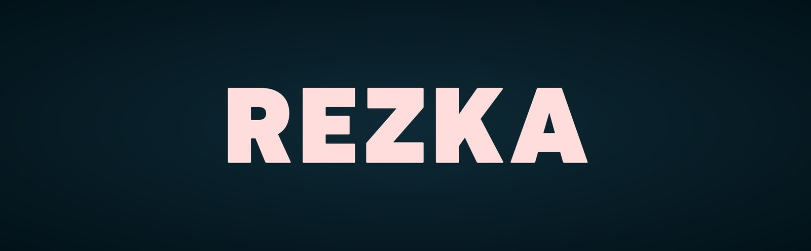
</p>

<h1 align="center">REZKA — HDrezka для Apple TV</h1>

<p align="center">
  Неофициальный клиент HDrezka для tvOS на SwiftUI + AVKit. Фильмы, сериалы, мультфильмы и аниме с пультом Siri Remote.
</p>

<p align="center">
  
  
  
  
</p>

> 📬 **По всем вопросам:** [mrgsdev@gmail.com](mailto:mrgsdev@gmail.com)

## Содержание

- [Возможности](#возможности)
  - [Главная](#главная)
  - [Каталоги, жанры и «Лучшие»](#каталоги-жанры-и-лучшие)
  - [Подборки и анонсы](#подборки-и-анонсы)
  - [Карточка фильма и сериала](#карточка-фильма-и-сериала)
  - [Плеер](#плеер)
  - [Закладки, поиск и настройки](#закладки-поиск-и-настройки)
  - [Вход в аккаунт](#вход-в-аккаунт)
- [Сборка и установка](#сборка-и-установка)
- [Структура проекта](#структура-проекта)
- [Отладка](#отладка)

## Возможности

### Главная

<table>
  <tr>
    <td width="50%">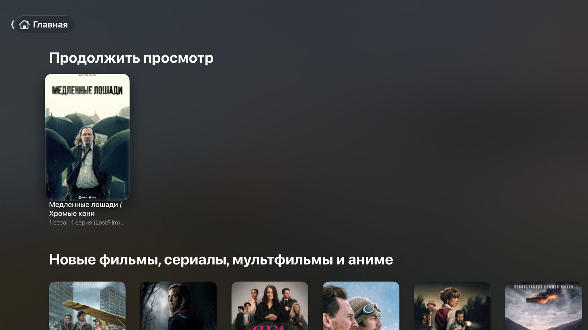</td>
    <td width="50%">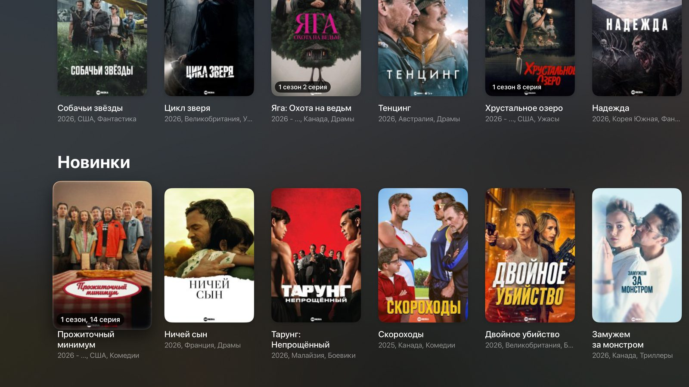</td>
  </tr>
</table>

- «Продолжить просмотр» синхронизируется с сайтом; долгое нажатие на постер убирает его из списка.
- «Новые фильмы, сериалы, мультфильмы и аниме» — тот же слайдер, что на главной сайта, с бейджами новых серий.
- Новинки, популярные фильмы и сериалы, «Сейчас смотрят», мультфильмы, аниме.

### Каталоги, жанры и «Лучшие»

<table>
  <tr>
    <td width="50%">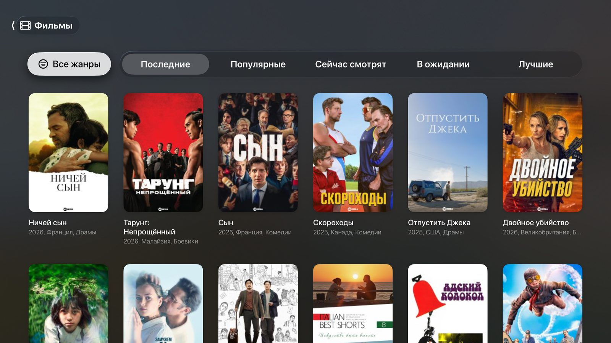</td>
    <td width="50%">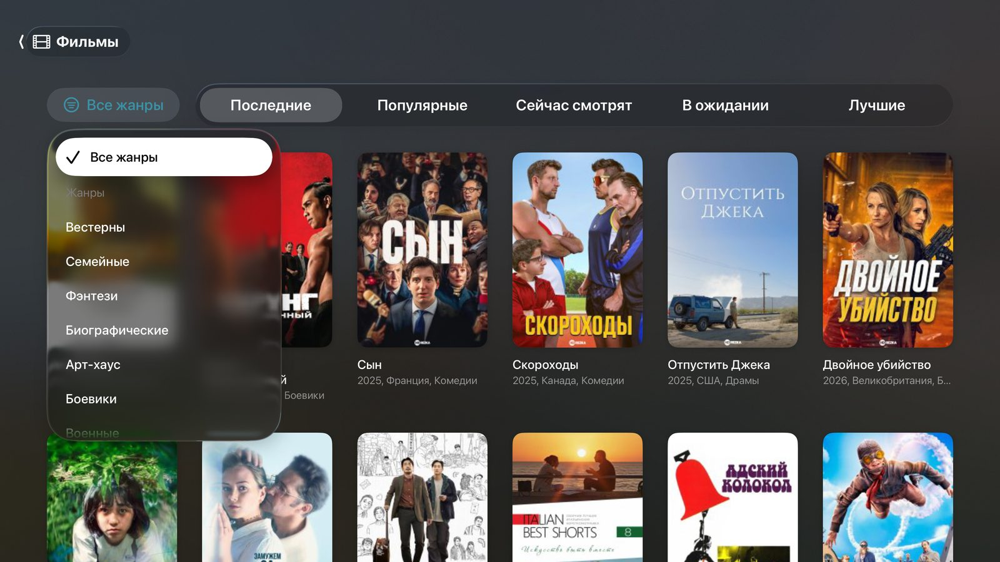</td>
  </tr>
  <tr>
    <td colspan="2" align="center">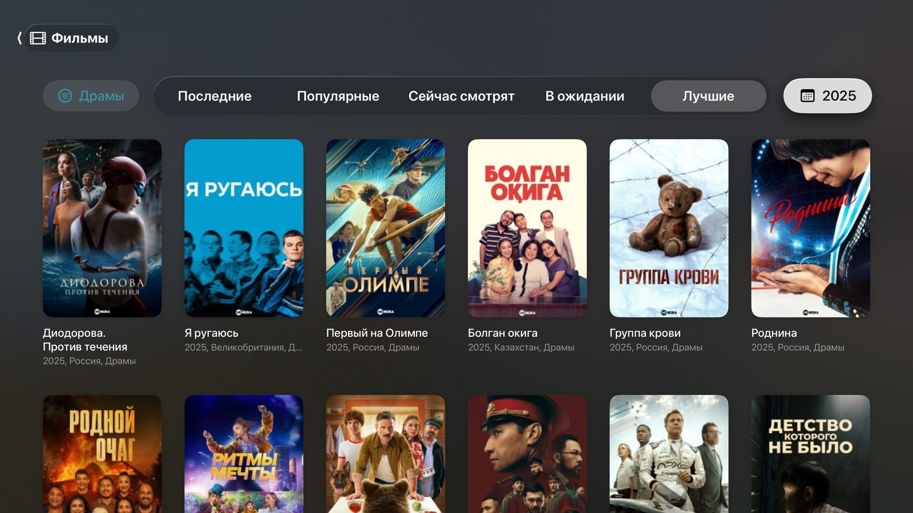</td>
  </tr>
</table>

- Разделы «Фильмы», «Сериалы», «Мультфильмы», «Аниме» с бесконечной прокруткой.
- Жанры и студии (Netflix, HBO, Amazon, Disney, Apple TV+) берутся из меню сайта — новые жанры появляются без обновления приложения.
- Сортировка: «Последние», «Популярные», «Сейчас смотрят», «В ожидании» и «Лучшие» — за любой год с 1896-го или за всё время, в том числе внутри жанра.

### Подборки и анонсы

<table>
  <tr>
    <td width="50%">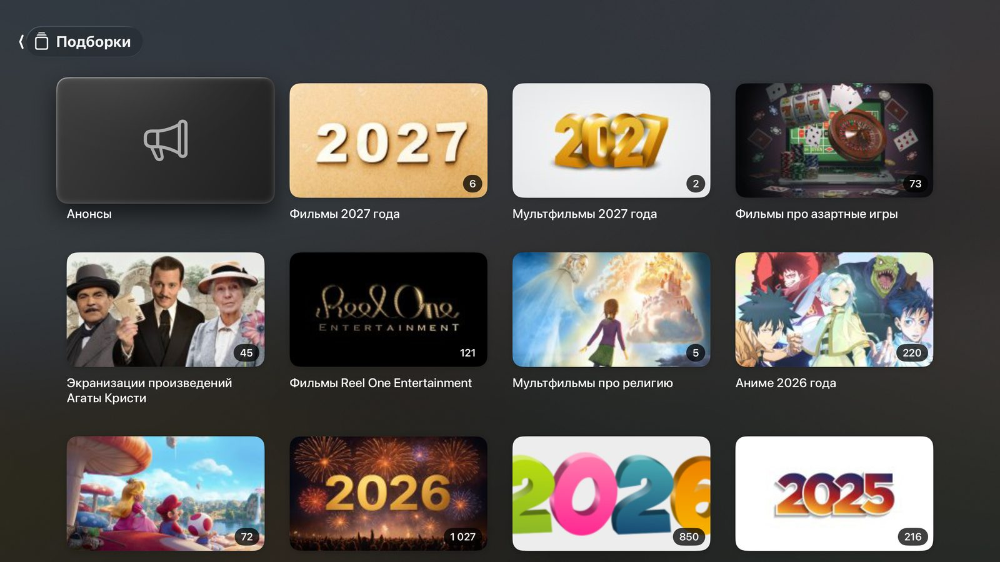</td>
    <td width="50%">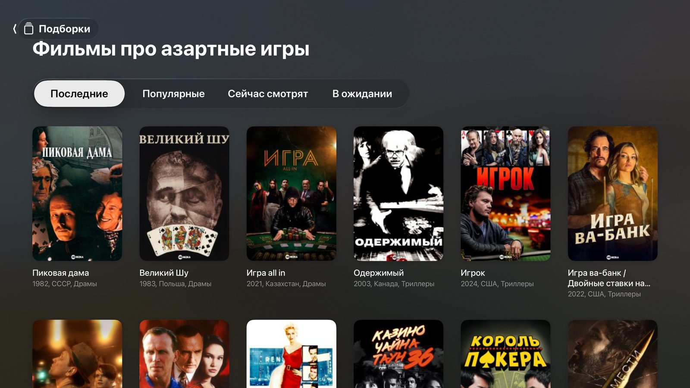</td>
  </tr>
</table>

- Все подборки сайта с обложками и числом тайтлов: «Фильмы 2027 года», «Сериалы Apple TV+», «Экранизации Агаты Кристи»…
- «Анонсы» — ещё не вышедшие фильмы и сериалы.
- Внутри подборки та же сортировка, что в каталоге.

### Карточка фильма и сериала

<table>
  <tr>
    <td width="50%">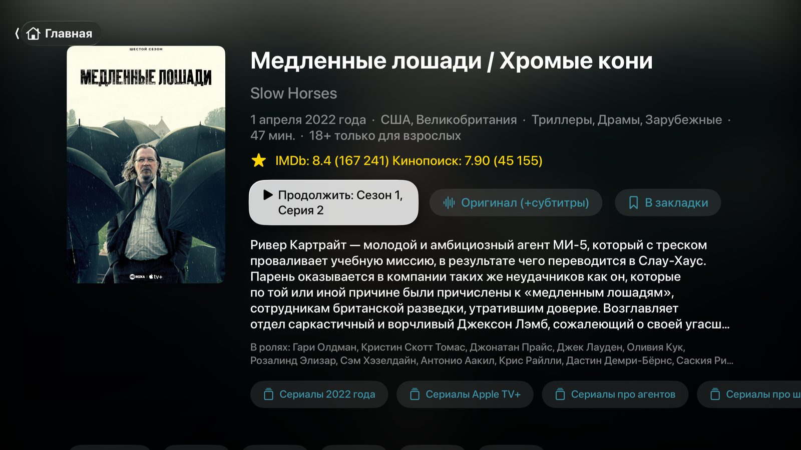</td>
    <td width="50%">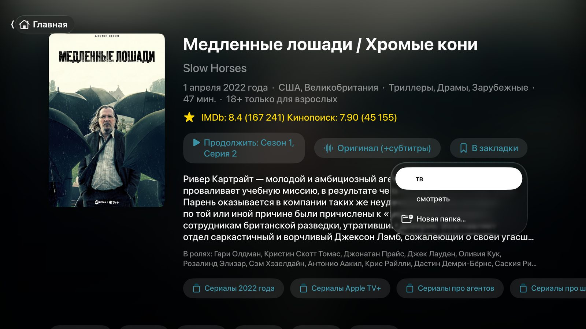</td>
  </tr>
  <tr>
    <td width="50%">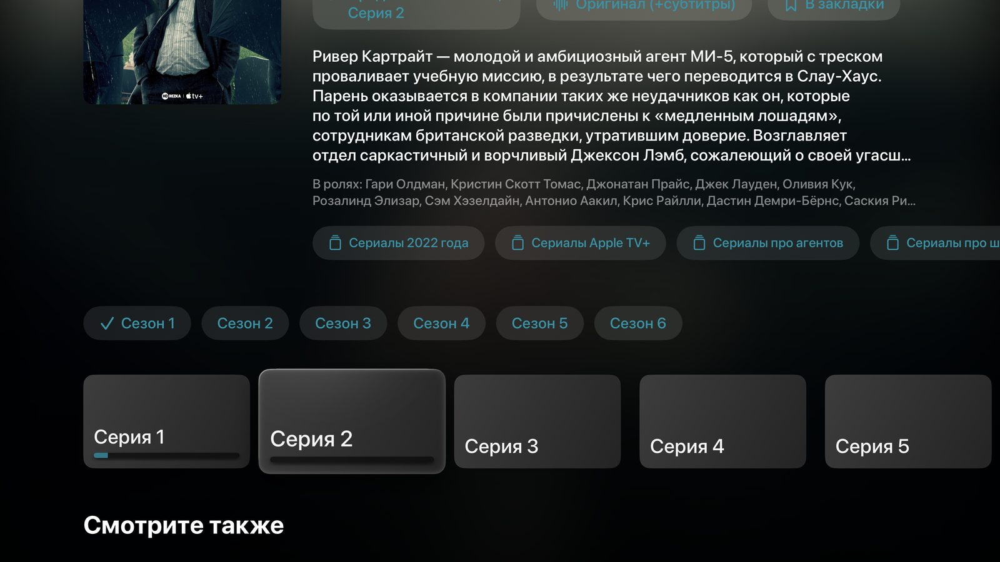</td>
    <td width="50%">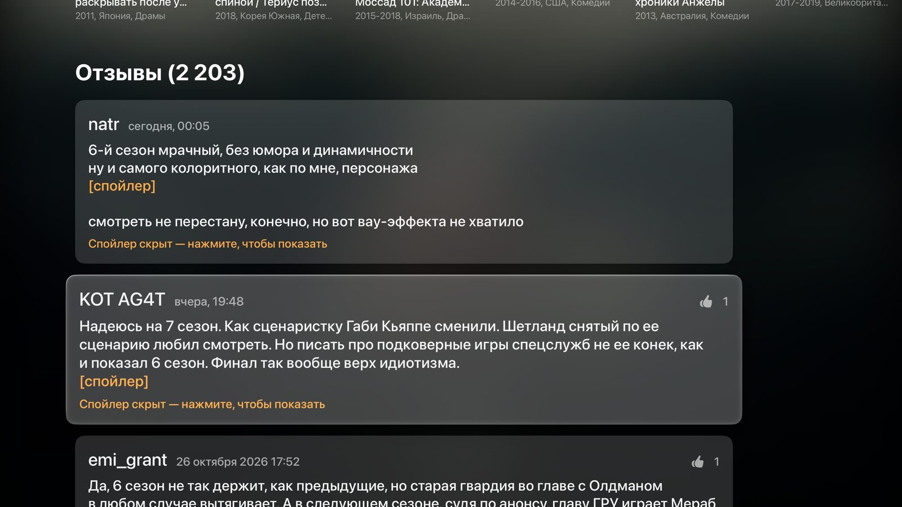</td>
  </tr>
</table>

- Описание, рейтинги IMDb и Кинопоиска, актёры, выбор озвучки (премиум-озвучки помечены и не выбираются без подписки).
- Кнопка «Продолжить» сразу ставит следующую непросмотренную серию.
- Меню «В закладки»: галочки у папок, где уже лежит тайтл; «Новая папка…» создаёт папку и сразу добавляет его туда.
- Строка «Из серии» — кнопки, которые открывают подборки, например «Сериалы 2022 года».
- Сезоны и серии с прогрессом просмотра, «Смотрите также».
- Отзывы с ответами и числом лайков; спойлеры скрыты и открываются нажатием, «Показать ещё отзывы» подгружает следующие 150.

### Плеер

<table>
  <tr>
    <td width="50%">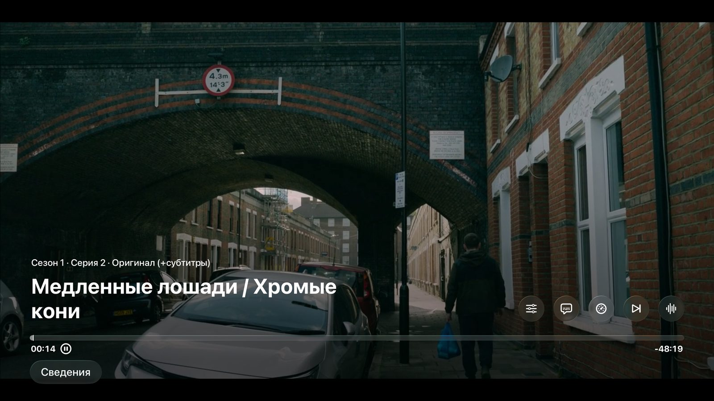</td>
    <td width="50%">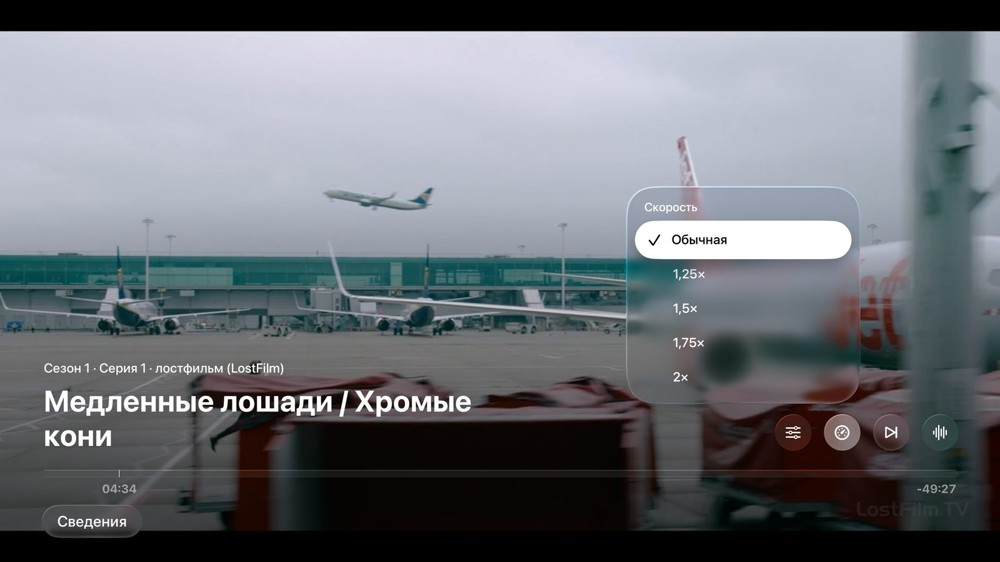</td>
  </tr>
</table>

- Системный плеер Apple TV с меню «Качество», «Скорость» (1–2×) и «Субтитры» в нижней панели.
- Субтитры WebVTT поверх видео, продолжение с места остановки, переход к следующей серии.
- Позиция просмотра отправляется на сайт, так что «Продолжить просмотр» совпадает с браузером.

### Закладки, поиск и настройки

<table>
  <tr>
    <td width="50%">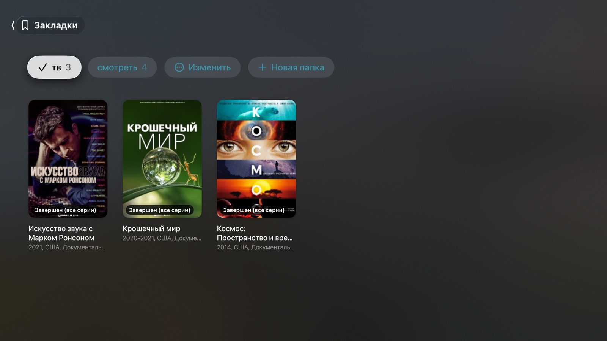</td>
    <td width="50%">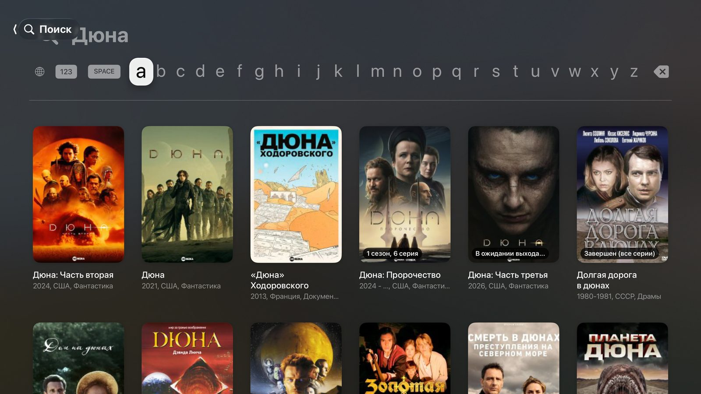</td>
  </tr>
  <tr>
    <td width="50%">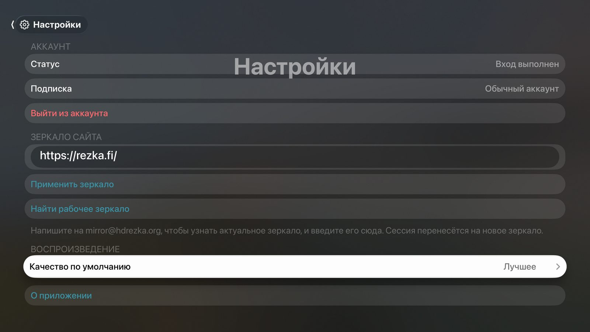</td>
    <td width="50%">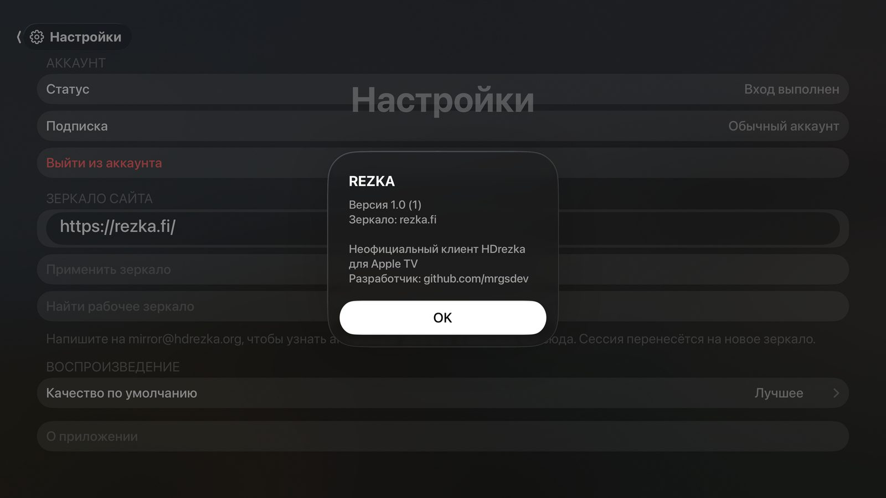</td>
  </tr>
</table>

- Закладки — папки с сайта: создание, переименование, удаление; долгое нажатие на постер убирает его из папки или переносит в другую.
- Поиск по фильмам, сериалам и мультфильмам.
- Смена зеркала с переносом сессии и кнопка «Найти рабочее зеркало», которая проверяет известные домены.
  Актуальный адрес приходит в ответ на письмо на mirror@hdrezka.org.
- Качество по умолчанию; «О приложении» с версией и текущим зеркалом.

### Вход в аккаунт

<p align="center">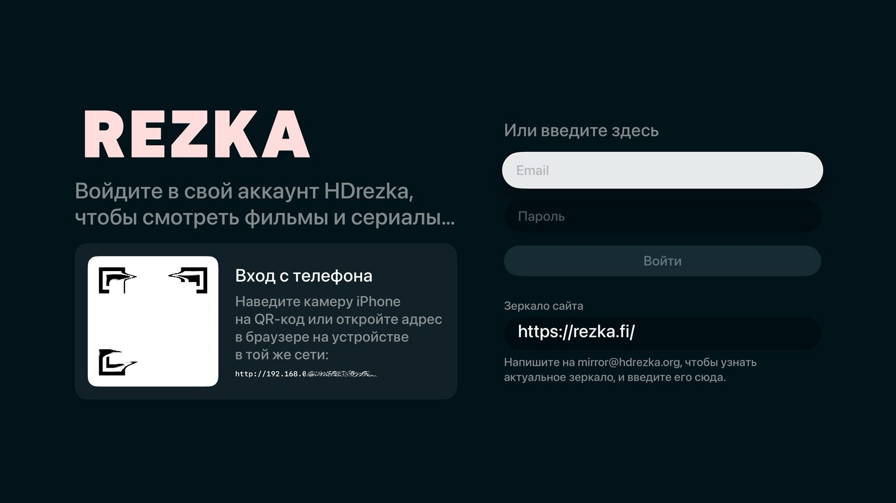</p>

Сайт сейчас пускает к контенту только после входа. Логин и пароль можно ввести пультом или с телефона:
экран входа показывает QR-код и адрес локальной страницы (порт 8765, одноразовый токен). Сессия хранится в Keychain.

## Сборка и установка

Нужен Xcode 26+ (проект создан в Xcode 27.1), tvOS 18+.

```bash
open HDrezkaTV.xcodeproj
```

Swift Package SwiftSoup подтянется автоматически. Для запуска на своей Apple TV:

1. Xcode → Settings → Accounts — добавить Apple ID (подойдёт бесплатный Personal Team).
   Если старые сертификаты отозваны: Manage Certificates → «+» → Apple Development.
2. Target **HDrezkaTV** → Signing & Capabilities → выбрать Team (если Xcode ругается на Bundle ID —
   поменять его на любой свой, например `com.<имя>.hdrezkatv`).
3. Apple TV и Mac в одной сети. На Apple TV: «Настройки → Пульты и устройства → Приложение Remote и устройства».
   В Xcode: Window → Devices and Simulators → Apple TV появится в списке → Pair → ввести код с экрана телевизора.
4. Выбрать Apple TV вверху Xcode как destination и нажать Run (⌘R). Первая установка занимает пару минут.

С бесплатным аккаунтом приложение работает 7 дней, потом нужно снова нажать Run в Xcode (вход и закладки сохранятся).
С платным Apple Developer ($99/год) — год, плюс можно ставить через TestFlight.

## Структура проекта

```
HDrezkaTV/
  App/          точка входа, вкладки
  Core/         зеркало, меню сайта (жанры), cookies в Keychain, сессия, прогресс просмотра
  Network/      RezkaClient — все запросы к сайту
  Parsing/      HTML-парсер (SwiftSoup), декодер ссылок на видео, WebVTT
  Features/     экраны: Home, Catalog, Collections, Search, Bookmarks, Details, Player, Auth, Settings
  UI/           общие компоненты (постеры, полки, сетка, пагинация)
```

Все CSS-селекторы собраны в `Parsing/RezkaParser.swift` — если сайт поменяет вёрстку, править нужно там.

## Отладка

- Запросы к сайту пишутся в системный лог (путь, статус, размер, время — без cookies):
  `xcrun simctl spawn booted log stream --predicate 'subsystem == "com.mrgsdev.hdrezkatv"'`
- Аргументы запуска (Scheme → Run → Arguments):
  - `-disableRemoteProgress YES` — не отправлять позицию просмотра на сайт (для тестов);
  - `-dumpHTTP YES` (Debug) — сохранять ответы сайта в `Library/Caches/http-debug` для проверки парсера.
- Сайт подвисает на пачках параллельных запросов, поэтому `RezkaClient` пускает не больше 3 одновременно.
- Премиум-качества («1080p Ultra») для бесплатного аккаунта отдаются минутным тизером — по умолчанию они не выбираются.
- Пустой список сайт отдаёт обычной страницей со статусом 404 — приложение показывает его как пустой, а не как ошибку.

## Благодарности

Разбор API и идеи взяты из открытых проектов
[rezka-payer](https://github.com/Agnidia/rezka-payer) и
[hdrezka-swiftui](https://github.com/voidboost/hdrezka-swiftui) (MIT).

## Отказ от ответственности

Проект не связан с HDrezka. Используйте на свой страх и риск и соблюдайте правила сайта и законы своей страны.
