<p align="center">
  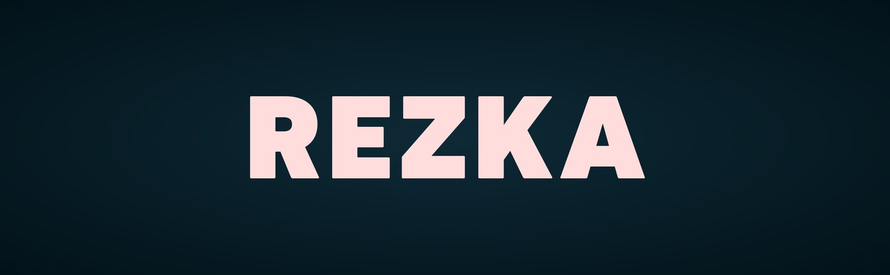
</p>

<h1 align="center">REZKA: HDrezka для Apple TV</h1>

<p align="center">
  Неофициальный нативный клиент HDrezka для Apple TV на SwiftUI и AVKit.<br>
  Фильмы, сериалы, мультфильмы и аниме на большом экране с пультом Siri Remote, и то, чего нет на сайте.
</p>

<p align="center">
  
  
  
  
  
</p>

<p align="center">
  📬 <a href="mailto:mrgsdev@gmail.com">mrgsdev@gmail.com</a> &nbsp;·&nbsp;
  💻 <a href="https://github.com/mrgsdev/HDRezka_macOS">Версия для Mac</a>
</p>

---

## Коротко

**Всё, что есть на сайте:** главная с полками, каталоги с жанрами, студиями и «Лучшими», передачи и шоу,
подборки и анонсы, поиск, карточка с рейтингами, оценкой и озвучками, сезоны и график выхода серий,
отзывы с лайками, страницы актёров и режиссёров, закладки по папкам, «Продолжить просмотр» синхронно
с сайтом, смена зеркала.

**Чего нет на сайте:** рулетка «Что посмотреть?» с фильтрами, «Итоги» просмотра с календарём и целью на год,
достижения, кинопаспорт, детский режим с PIN-кодом, карточка тайтла по фокусу на постере, родной плеер
Apple TV с процентом загрузки, вход с телефона по QR-коду, знакомство с приложением и английский интерфейс.

## Содержание

- [Что есть на сайте и в приложении](#что-есть-на-сайте-и-в-приложении)
- [Чего нет на сайте](#чего-нет-на-сайте)
- [Установка](#установка)
- [Для разработчиков](#для-разработчиков)
- [Благодарности](#благодарности) · [Отказ от ответственности](#отказ-от-ответственности)

---

## Что есть на сайте и в приложении

### 🏠 Главная

«Продолжить просмотр» с сайта, новые фильмы, сериалы, мультфильмы и аниме, новинки, популярное
и «Сейчас смотрят». На постерах метки «Фильм», «Сериал», «Мультфильм» и «Аниме», как на сайте.
Долгое нажатие убирает постер из «Продолжить просмотр». Разделы открываются в боковом меню нажатием влево.

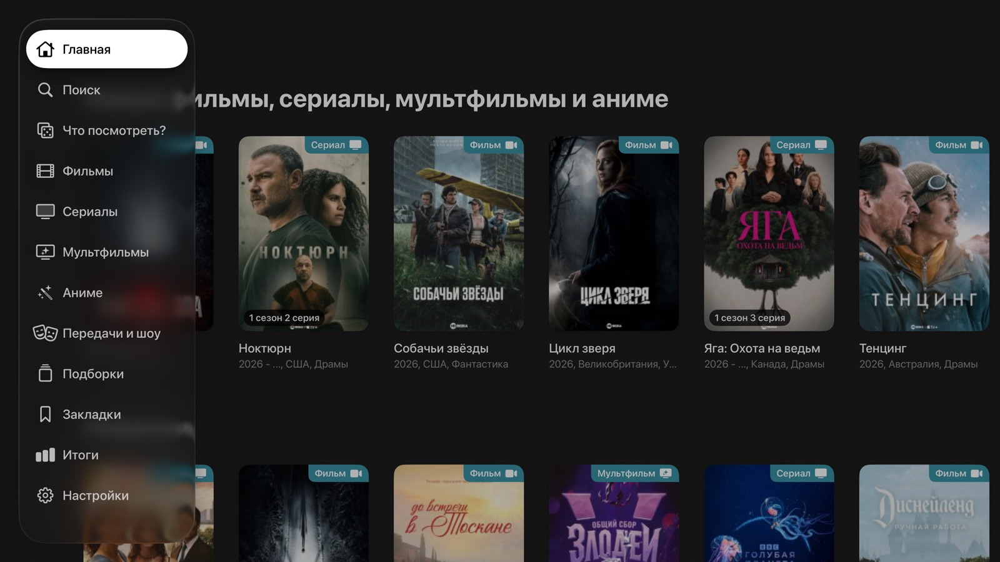

### 🎬 Каталог, жанры и «Лучшие»

Фильмы, сериалы, мультфильмы, аниме, передачи и шоу с бесконечной прокруткой. Жанры и студии берутся
из меню сайта, сортировка: «Последние», «Популярные», «Сейчас смотрят», «В ожидании» и «Лучшие» за любой год.

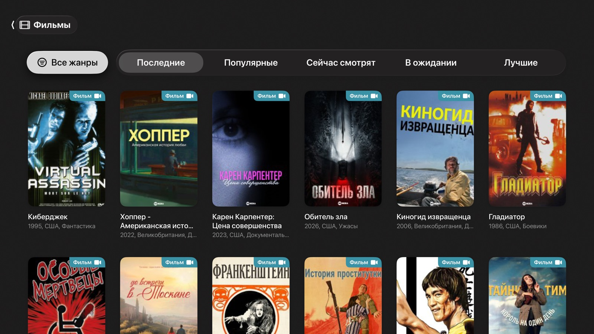

### 🗂 Подборки и анонсы

Все подборки сайта («Фильмы 2026 года», «Сериалы Apple TV+»…) и анонсы.

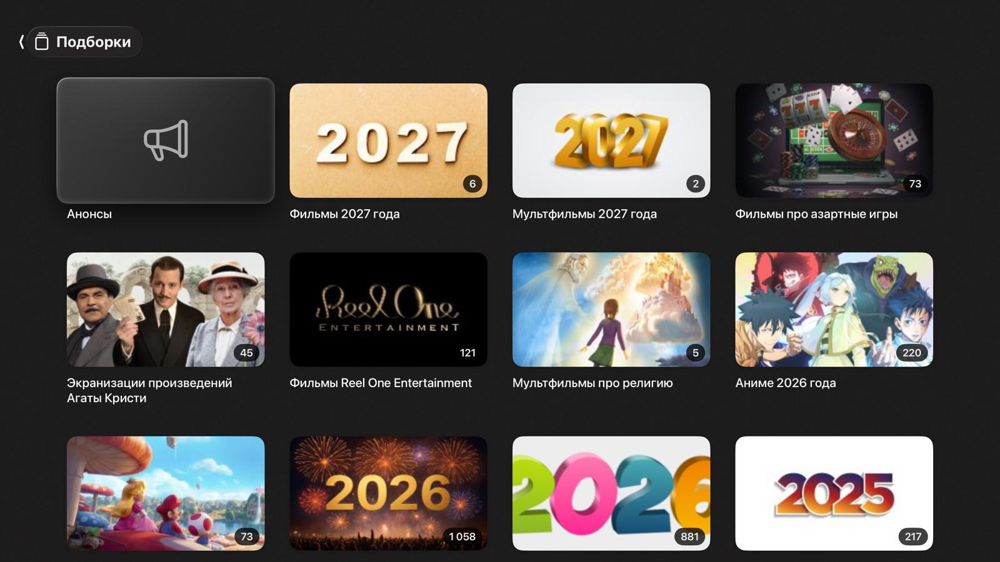

### 🔍 Поиск

Поиск по фильмам, сериалам и мультфильмам во вкладке «Поиск».

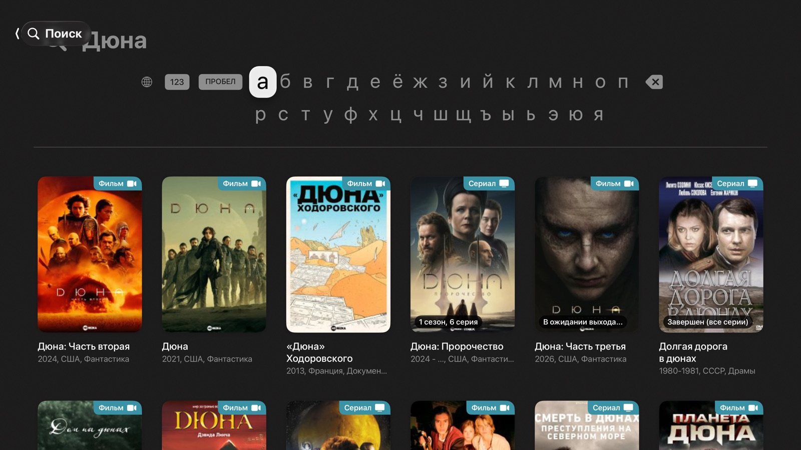

### 🎞 Карточка фильма и сериала

Рейтинги IMDb и Кинопоиска, рейтинг сайта и ваша оценка, выбор озвучки с её сезонами и подсказкой
«какую выбирают зрители», трейлер, закладки, режиссёры и актёры, списки «Лучших» и подборки,
в которые входит тайтл. Если видео недоступно в вашем регионе, карточка так и скажет.

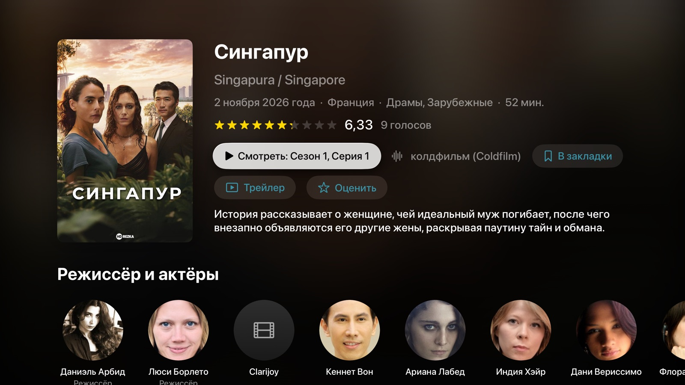

Трейлер открывается в приложении YouTube, а если его нет, карточка покажет QR-код для телефона.
Оценку сайт принимает один раз, поэтому приложение переспрашивает перед отправкой.

### 📺 Сезоны, серии и график выхода

Серии с полосками просмотра, график выхода с отметками «просмотрено», которые синхронизируются с сайтом.

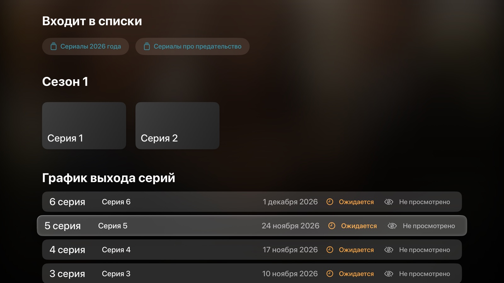

### 💬 Отзывы

Отзывы с ответами, спрятанные спойлеры и лайки «Поддерживаю!» долгим нажатием на отзыв.

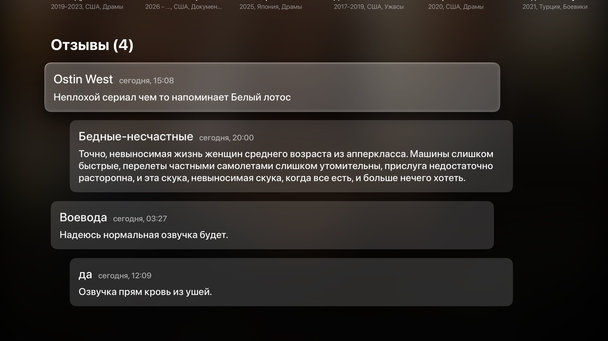

### 🎭 Актёры и режиссёры

Полка «Режиссёр и актёры» в карточке и страница человека со всеми его фильмами и сериалами на сайте.

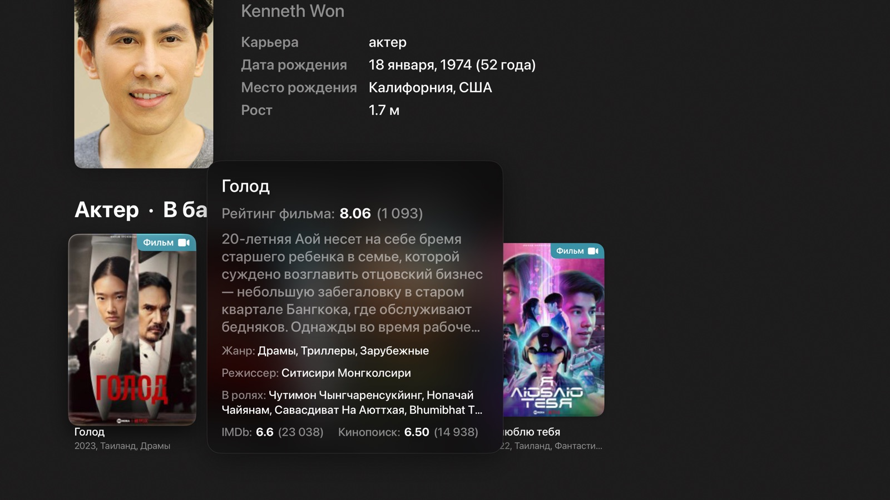

### 🔖 Закладки

Папки закладок с сайта: создание, переименование, удаление, перенос тайтлов между папками.

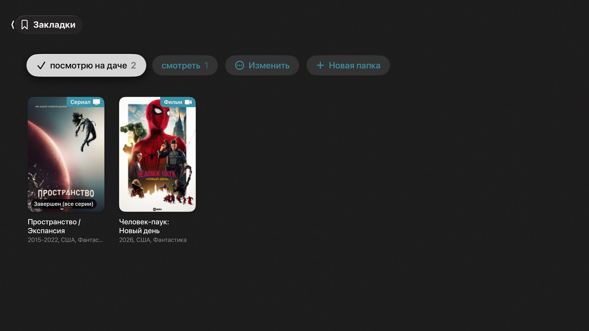

### 🔐 Вход и зеркала

Логин и пароль можно ввести пультом или с телефона: экран входа показывает QR-код и адрес локальной
страницы, и данные уходят на телевизор по домашней сети. Сессия хранится в связке ключей.
Зеркало можно сменить ещё до входа, а «Найти рабочее зеркало» в настройках проверит известные адреса.

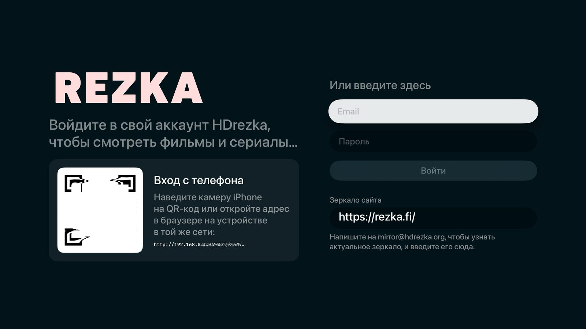

---

## Чего нет на сайте

### 🎲 Что посмотреть?

Лента постеров раскручивается и останавливается на случайном фильме или сериале, или сразу,
если включить «Без анимации». Фильтры: раздел, несколько жанров, страны, годы и рейтинг IMDb.

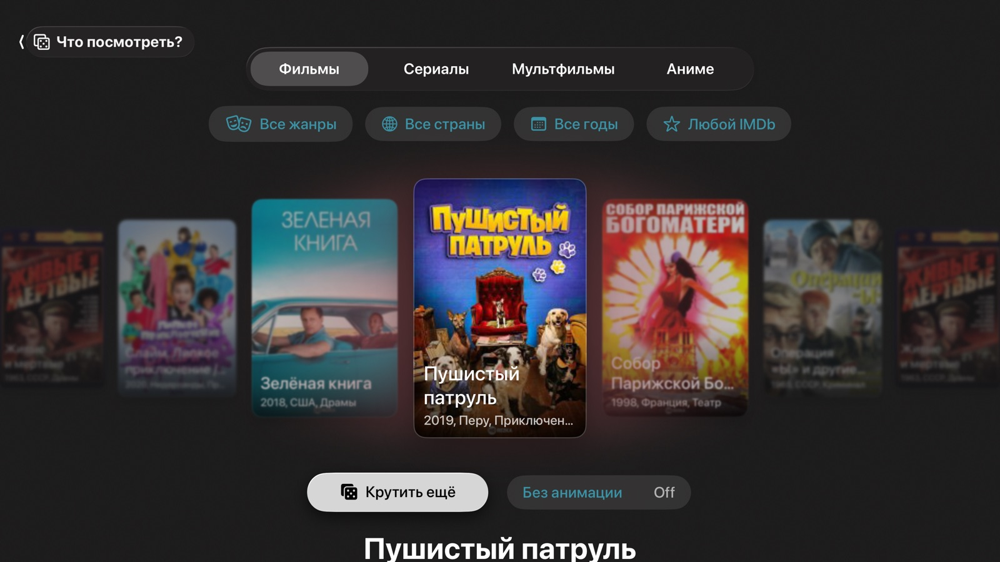

### 📊 Итоги

Сколько посмотрено за месяц, год или всё время, начиная с ноября 2026: цель на год, график,
календарь просмотров, любимые жанры и озвучки, самые просматриваемые тайтлы. Считается то,
что играло в REZKA на этом Apple TV, и данные хранятся только на нём.

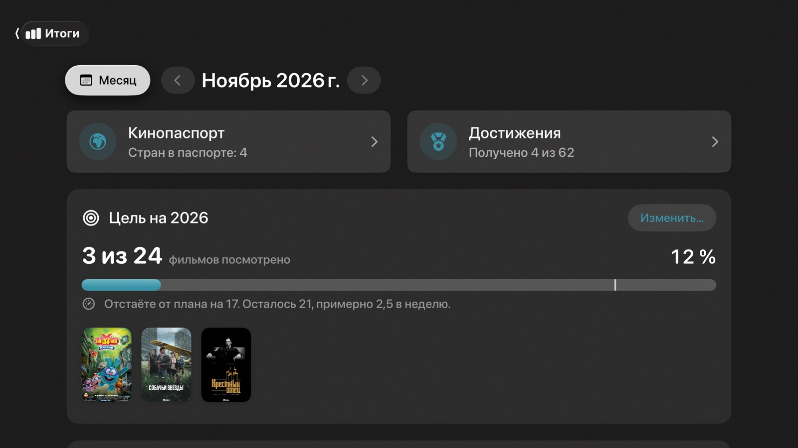

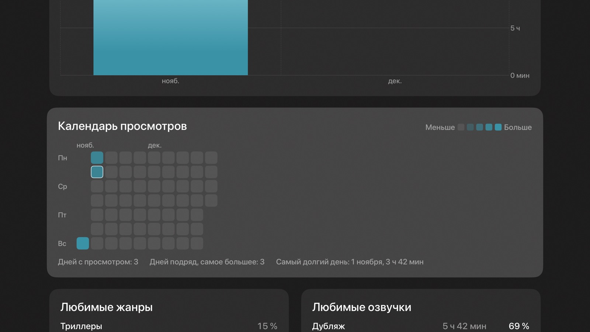
<sub>На скриншотах Итогов, достижений и кинопаспорта примерные данные.</sub>

### 🏅 Достижения

62 медали в стиле Apple Watch за фильмы, сериалы, привычки и страны. О новой медали сообщает окно
вверху экрана, оно видно и поверх плеера.

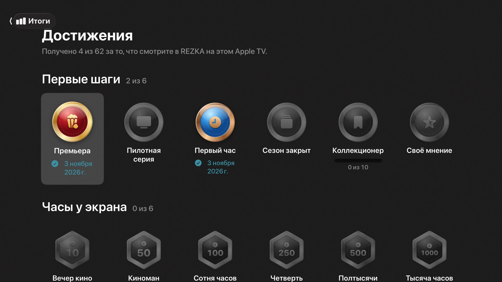

### 🌍 Кинопаспорт

Штампы стран, откуда были фильмы и сериалы. С пятого тайтла страны штамп становится золотой визой,
с двадцатого видом на жительство. Штамп открывает фильмы этой страны на сайте.

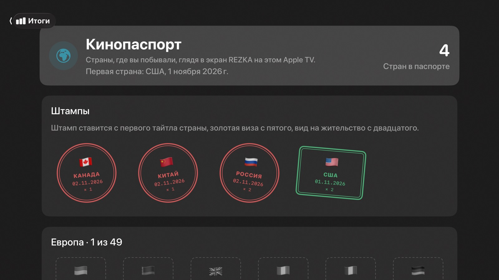

### 🔒 Детский режим

Фильмы и сериалы старше 0+, 6+, 12+ или 16+ скрыты и не запускаются, отзывы спрятаны.
Изменить или выключить режим можно только с PIN-кодом, а забытый PIN восстанавливается кодом,
который показывается один раз.

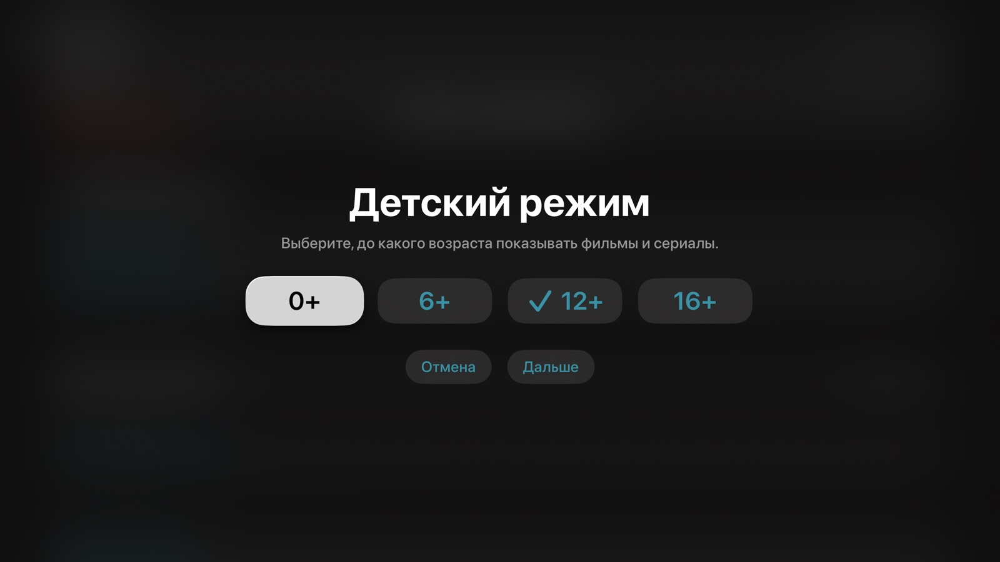

### 💡 Карточка на постере

Задержите фокус на постере, и рядом появится карточка с сайта: рейтинг, начало описания,
жанры, режиссёр, актёры, IMDb и Кинопоиск.

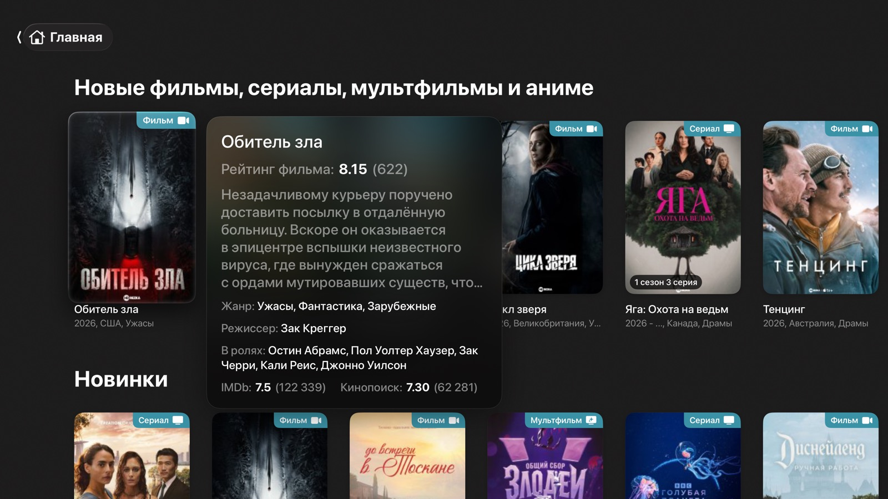

### ▶️ Плеер

Родной плеер Apple TV: качество, субтитры, скорость до 2× и «Следующая серия» в меню, а под названием
видно, насколько серия загрузилась для быстрой перемотки. Позиция запоминается и уходит на сайт.

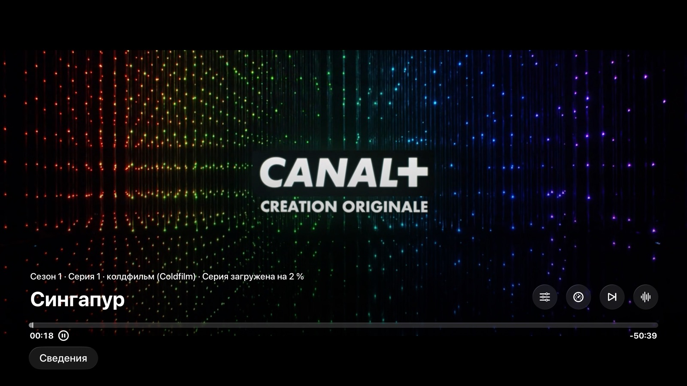

### 👋 Знакомство

Девять страниц о том, что есть в приложении: один раз после входа и снова из Настроек.
В конце записка разработчика и отказ от ответственности.

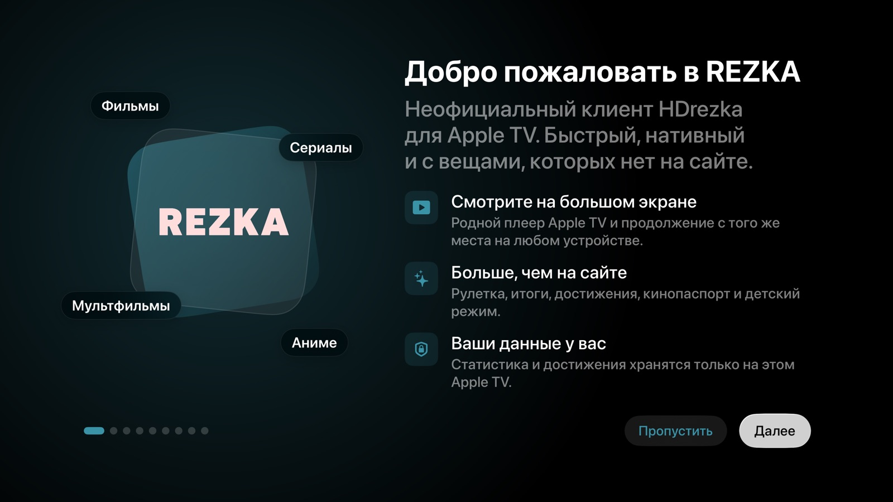

### 🇬🇧 Английский интерфейс

По языку системы Apple TV. Названия и описания приходят с сайта и остаются на русском.


### ⚙️ Настройки

Аккаунт и Premium, зеркало, качество по умолчанию, детский режим, знакомство и «О приложении».

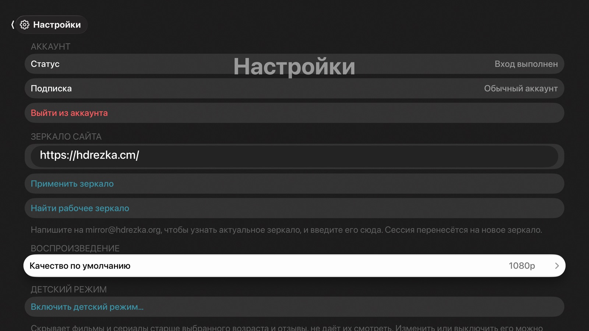

---

## Установка

Приложения нет в App Store, его ставят из Xcode на свою Apple TV. Нужен Xcode 26+ и tvOS 18+.

1. Xcode → Settings → Accounts: добавить Apple ID (подойдёт бесплатный Personal Team).
   Если старые сертификаты отозваны: Manage Certificates → «+» → Apple Development.
2. Открыть проект:

   ```bash
   open HDrezkaTV.xcodeproj
   ```

   Swift Package SwiftSoup подтянется автоматически.
3. Target **HDrezkaTV** → Signing & Capabilities: выбрать свой Team. Если Xcode ругается на Bundle ID,
   поменять его на любой свой, например `com.<имя>.hdrezkatv`.
4. Apple TV и Mac в одной сети. На Apple TV: «Настройки → Пульты и устройства → Приложение Remote и устройства».
   В Xcode: Window → Devices and Simulators, Apple TV появится в списке, Pair, ввести код с экрана телевизора.
5. Выбрать Apple TV вверху Xcode и нажать Run (⌘R). Первая установка занимает пару минут.

С бесплатным аккаунтом приложение работает 7 дней, потом нужно снова нажать Run в Xcode (вход, закладки
и Итоги сохранятся). С платным Apple Developer ($99 в год) срок год, и можно ставить через TestFlight.

## Для разработчиков

<details>
<summary><b>Структура проекта</b></summary>

```
HDrezkaTV/
  App/          точка входа, вкладки бокового меню, знакомство при первом входе
  Core/         зеркало, меню сайта (жанры), cookies в Keychain, сессия, прогресс просмотра, вход с телефона
  Network/      RezkaClient: все запросы к сайту
  Parsing/      HTML-парсер (SwiftSoup), декодер ссылок на видео, WebVTT
  Models/       модели данных сайта
  Features/     экраны: Home, Catalog, Collections, Search, Roulette, Stats, Bookmarks, Details,
                Person, Player, Parental, Onboarding, Auth, Settings
  UI/           общие компоненты (постеры, полки, сетка, карточка на постере, цвета)
  Localizable.xcstrings  строки интерфейса: русский (исходный) и английский
```

Все CSS-селекторы собраны в `HDrezkaTV/Parsing/RezkaParser.swift`: если сайт поменяет вёрстку, править нужно там.
Сеть, парсер и модели общие с [версией для Mac](https://github.com/mrgsdev/HDRezka_macOS) (там они лежат
в `REZKA/Shared`), так что исправления стоит переносить в оба проекта.

</details>

<details>
<summary><b>Отладка</b></summary>

- Запросы к сайту пишутся в системный лог (путь, статус, размер, время, без cookies):
  `xcrun simctl spawn booted log stream --predicate 'subsystem == "com.mrgsdev.hdrezkatv"'`
- Аргументы запуска (Scheme → Run → Arguments):
  - `-disableRemoteProgress YES`: не отправлять позицию просмотра на сайт (для тестов);
  - `-dumpHTTP YES` (Debug): сохранять ответы сайта в `Library/Caches/http-debug` для проверки парсера.
- Сайт подвисает на пачках параллельных запросов, поэтому `RezkaClient` пускает не больше 3 одновременно.
- Премиум-качества («1080p Ultra») для бесплатного аккаунта отдаются минутным тизером, поэтому по умолчанию они не выбираются.
- Пустой список сайт отдаёт обычной страницей со статусом 404, и приложение показывает его как пустой, а не как ошибку.

</details>

## Благодарности

Разбор API и идеи взяты из открытых проектов
[rezka-payer](https://github.com/Agnidia/rezka-payer) и
[hdrezka-swiftui](https://github.com/voidboost/hdrezka-swiftui) (MIT).

## Отказ от ответственности

* Эта программа предоставляется «как есть».
* Проект не связан с HDrezka и не является его официальным клиентом.
* Автор не поощряет какую-либо незаконную деятельность.
* Используйте её исключительно на свой страх и риск и соблюдайте законы своей страны.
* Также рекомендуется ознакомиться с [правилами сайта](https://rezka.ag/rules/).
